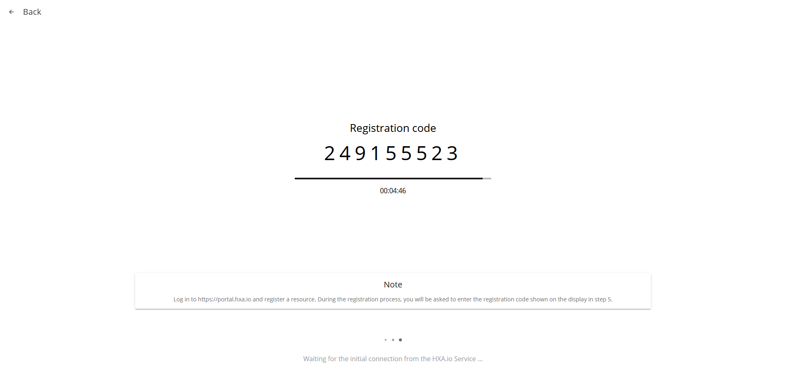

# Room Board Setup

Use a Room Board resource to configure the rooms and information presented on a shared overview display.

## Open the resource

In the [HXA.io Portal](https://portal.hxa.io), open **Resources**, find the Room Board resource, and choose **Options > Edit Resource**. Review its display name, language, location, Building, Floor, and Floorlabel.

## License and connector

Check **Licensing** and any **Licensing - Add-ons** assignments. The **Connector** section displays the main connection and, where configured, an **Optional Connector**. Prepare the connection before choosing rooms; see [Connector Setup](/setup/connector-setup/connector-setup.md).

## Register a display

1. Start the Room Board application and choose **Register** to obtain its registration code.
2. In the resource, find **Application/ Devices** and choose **Add**.
3. Enter the code shown on the display and complete registration.
4. Check the device table for **Online**, **App-Version**, **Platform**, and **Last online** information.

The table also includes Serial No., Device ID, Register date, and Options. See [Device Monitoring](/maintenance/device-monitoring.md) for the central overview.

## Choose rooms

**Rooms to be displayed** contains **Load**, a room table, and **Save**. Review the loaded rooms and select the intended entries using **Display**. The table includes **Room Name**, **Building**, **Calendar**, and a **Direction** selection. Use this section's **Save** button for the room selection.

## Advanced settings

| Setting | Purpose |
| --- | --- |
| Switching time between the pages (in seconds) | Page-switching interval |
| Enable floor plan | Floor-plan display option |
| Display weather forecast | Weather display option |
| Add location | Location for the weather configuration |
| Table View Configuration | Controls for Organizer, Subject, Direction, and Floor Plan, alongside Room Name, Start, and End |

Use **Save and Update**. Review feature-version notices for the connected devices; availability can differ when older clients are attached.

## Resource picture and presentation content

The resource-picture upload recommends **800 × 800 pixels** and accepts **jpeg**, **jpg**, and **png**. **Load standard picture** is available separately.

**Advertising and information presentation** provides slots for an **image**, **Web URL**, or **video**. Images in these slots are limited to **1 MB**. Review the section's license and client-version notices before preparing content.

## Verify the display

Reopen the resource to review saved selections. On the connected Room Board, check the room list, displayed columns, page switching, and any enabled weather, floor-plan, or presentation content.
