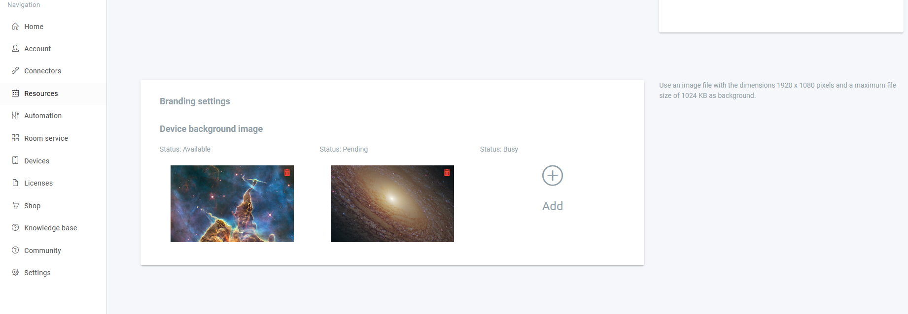
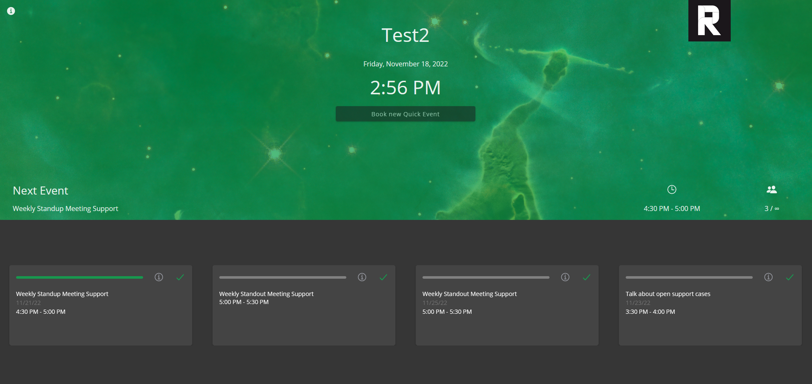

# How to setup the background image of your device

To customize your Room Booking device, configure status-specific backgrounds on its resource. These backgrounds are separate from the resource-picture upload and the organization's logo.

+++ 1. Setup background image
- [x] Go to [HXA.io Portal](https://portal.hxa.io) page and type in your username and password
- [x] Open **Resources**.
- [x] Open the resource's **Options** menu and choose **Edit Resource**.
- [x] Scroll to **Branding settings > Device background image**.
- [x] Choose the intended status: **Available**, **Pending**, or **Busy**. Each status has its own image.
- [x] Upload the background images for every status by clicking on "Add" (resolution: 1920 x 1080 pixels; max file size: 1024 kB)

- [x] :icon-shield-check: Enjoy your individual background images

+++

## Other image settings

| Setting | Location | Portal guidance |
| --- | --- | --- |
| Resource images | Resource configuration > Resource images | Up to three images, each at most 1 MB |
| Resource picture | Separate resource-picture upload | Recommended 800 × 800 pixels; jpeg, jpg, png |
| Organization logo | Account > Organization Profile > Branding settings | At most 1 MB; 2:3 width-to-height ratio |

After changing an image, check its appearance on the connected display for the relevant status.

<!-- Source for current paths, statuses, and the separate image settings: authenticated portal inspection, 2026-11-20, P02 and P05. The existing 1920x1080 / 1024 kB background guidance above was retained from the previous article; the upload dialog was not reopened to revalidate those limits. -->

